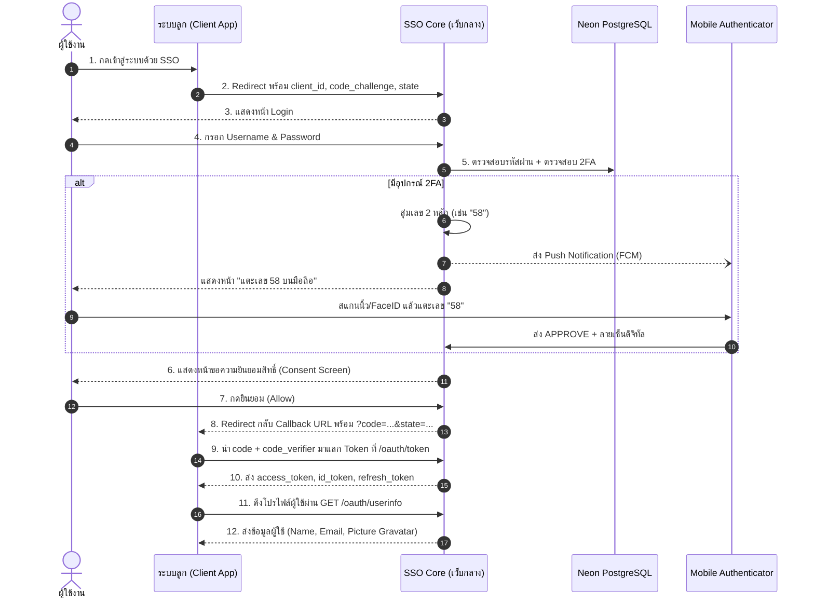

# 🛡️ SSO Core & Mobile Push 2FA (Identity Provider)

ระบบยืนยันตัวตนกลาง (Centralized Identity Provider - IdP) ระดับ Enterprise ที่รองรับมาตรฐานสากล **OAuth 2.0 (RFC 6749)**, **PKCE (RFC 7636, S256)**, **OpenID Connect Core 1.0 (OIDC Discovery RFC 8414, JWKS RFC 7517)** พร้อมระบบยืนยันตัวตนแบบสองขั้นตอนผ่านมือถือ **Mobile Push 2FA (Number Matching 2 หลัก + Asymmetric Digital Signature)** และหน้าจัดการ **Enterprise Identity Console**

---

## 🌟 ฟีเจอร์หลัก (Key Capabilities)

### 1. มาตรฐานการยืนยันตัวตนสากล (OAuth 2.0 & OpenID Connect)
* **OIDC Discovery Endpoint**: `/.well-known/openid-configuration` รองรับ Client Auto-discovery
* **JWKS Endpoint**: `/.well-known/jwks.json` สำหรับตรวจสอบลายเซ็น ID Token / JWT
* **OAuth 2.0 Authorization Code Flow**:
  - บังคับใช้ **PKCE (Proof Key for Code Exchange)** แบบ `code_challenge_method=S256` สำหรับ Public Client
  - ป้องกัน CSRF ด้วย `state` parameter
* **Refresh Token Rotation (RTR)**: หมุนเวียน Refresh Token ใหม่ทุกครั้งที่ใช้งาน พร้อมเพิกถอน Token เก่าทันที
* **OIDC UserInfo Endpoint**: `/api/v1/oauth/userinfo` คืนค่า Claims ข้อมูลโปรไฟล์ตาม Scopes (`openid`, `profile`, `email`)
* **Gravatar Integration**: ดึงรูปโปรไฟล์จริงผ่าน MD5 Hash ของอีเมลอัตโนมัติ (Fallback เป็น Identicon)

### 2. ระบบ Mobile Push 2FA (Number Matching & Device Trust)
* **การผูกอุปกรณ์ด้วย QR Code**: ออก `pairingToken` (อายุ 10 นาที) เพื่อผูกแอปมือถือเข้ากับบัญชี
* **Number Matching 2 หลัก**: สุ่มตัวเลข 2 หลัก (เช่น `47`) ขึ้นบนหน้าเว็บ เพื่อให้ผู้ใช้แตะเลือกบนมือถือ ป้องกัน Push Fatigue Attack (MFA Spamming)
* **Asymmetric Key Signature**: ถอดรหัสและตรวจสอบลายเซ็นดิจิทัลจาก Keystore / Secure Enclave ของมือถือ
* **Emergency Recovery Codes**: ระบบรหัสสำรองฉุกเฉิน 10 ชุด (เข้ารหัส Hash ทางเดียว) กรณีมือถือสูญหาย

### 3. หน้าจัดการ Enterprise Identity Console
* **User Directory ([/admin/users](http://localhost:3000/admin/users))**:
  - ค้นหาและกรอง Role (`ADMIN` / `USER`)
  - เพิ่มผู้ใช้ใหม่พร้อมตัวสุ่มรหัสผ่านที่ปลอดภัย
  - แก้ไขโปรไฟล์, ปรับสิทธิ์ และรีเซ็ตรหัสผ่าน
  - ตรวจสอบสถานะการผูกอุปกรณ์ 2FA ของผู้ใช้แต่ละคน
* **OAuth 2.0 Clients Management ([/admin/clients](http://localhost:3000/admin/clients))**:
  - ลงทะเบียนแอปพลิเคชันระบบลูก (Confidential และ Public Client)
  - กำหนด Redirect URIs และ Allowed Scopes
  - **Regenerate Client Secret**: สุ่มสร้าง Secret ใหม่พร้อมระบบยกเลิก Secret เดิมทันที
* **UI/UX ทันสมัย**:
  - Dark Theme สไตล์คอนโซลระดับองค์กรด้วย **HeroUI** + **Tailwind CSS**
  - แถบเมนูข้าง (Sidebar) ย่อ/ขยายได้ด้วยปุ่ม คีย์ลัด (`Ctrl+B`) หรือลากเมาส์ปรับความกว้างอิสระ
  - แอนิเมชันนุ่มนวลด้วย **GSAP**
  - หน้าต่าง Modal เรนเดอร์ผ่าน **React Portal** แสดงกึ่งกลางจออย่างแม่นยำ พร้อมมืดสนิททั้งหน้าจอ (`100vw` x `100vh`)

---

## 🏗️ แผนภาพสถาปัตยกรรม (Architecture Flow)



---

## 🛠️ Tech Stack

* **Framework**: [Next.js 15 (App Router)](https://nextjs.org/) (JavaScript / JSX)
* **Styling & UI**: [HeroUI](https://heroui.com/) (`@heroui/react` v2), [Tailwind CSS v3](https://tailwindcss.com/), [Lucide Icons](https://lucide.dev/), [GSAP](https://gsap.com/)
* **Database & ORM**: [Prisma ORM 6](https://www.prisma.io/) + [Neon PostgreSQL](https://neon.tech/) (Serverless)
* **Security & Crypto**: `bcryptjs`, `jsonwebtoken`, Node.js `crypto` (SHA-256, Ed25519, MD5 Gravatar)
* **Documentation & Testing**: OpenAPI 3.0.3, Scalar API Reference, Swagger UI, Postman Collection (v2.1.0)

---

## 📁 โครงสร้างโฟลเดอร์ (Directory Structure)

```
web-next/
├── app/
│   ├── (auth)/                    # หน้าเข้าสู่ระบบและยืนยันตัวตน
│   │   ├── login/                 # หน้า Login UI
│   │   ├── challenge/[id]/        # หน้าแสดงตัวเลข 2FA Number Matching
│   │   └── consent/               # หน้าขอความยินยอมสิทธิ์ (OAuth Scope Consent)
│   ├── (dashboard)/               # หน้า Enterprise Admin Console
│   │   ├── admin/
│   │   │   ├── clients/           # จัดการ OAuth 2.0 Clients & Regenerate Secret
│   │   │   └── users/             # จัดการ User Directory & RBAC & Reset Password
│   │   └── settings/
│   │       ├── security/          # หน้าผูกอุปกรณ์ 2FA QR Code & Recovery Codes
│   │       └── preferences/       # ตั้งค่าระบบและธีม
│   ├── api/
│   │   ├── v1/
│   │   │   ├── auth/              # Login, Logout, Me, 2FA Challenge Status
│   │   │   ├── oauth/             # Authorize, Token, Consent, UserInfo
│   │   │   ├── devices/           # QR Pairing, Unpair, 2FA Verification
│   │   │   └── admin/             # REST API จัดการ Clients และ Users
│   │   └── auth/callback/         # Demo OAuth Callback สำหรับทดสอบ
│   ├── .well-known/               # OIDC Discovery (openid-configuration) & JWKS
│   ├── docs/                      # Interactive API Documentation (Scalar / Swagger)
│   ├── layout.jsx                 # Global Root Layout
│   └── providers.jsx              # HeroUI Provider & Console Settings Context
├── lib/
│   ├── prisma.js                  # Singleton Prisma Client
│   ├── audit.js                   # บันทึก Audit Log และ Session Access Log
│   ├── gravatar.js                # คำนวณ Gravatar URL จาก Email
│   └── generated/prisma/          # Generated Prisma Client
├── postman/                       # ชุดทดสอบ Postman Collection & Environment
│   ├── SSO_Core_2FA.postman_collection.json
│   ├── SSO_Core_Local.postman_environment.json
│   └── README.md
├── prisma/
│   ├── schema.prisma              # 7 Prisma Data Models
│   └── seed.js                    # ข้อมูลเริ่มต้น (Admin & Demo Client)
├── public/                        # Static Assets
├── SSO-MOBILE.md                  # สเปกและข้อกำหนดสำหรับพัฒนา Mobile Authenticator App
└── vercel.json                    # ตั้งค่า Deployment บน Vercel (Region: sin1)
```

---

## 🚀 เริ่มต้นใช้งานในเครื่อง (Local Development Setup)

### 1. ติดตั้ง Dependencies
```bash
npm install --legacy-peer-deps
```

### 2. ตั้งค่า Environment Variables
คัดลอกไฟล์ `.env.example` ไปเป็น `.env` แล้วระบุค่าของคุณ:
```bash
cp .env.example .env
```

แก้ไขไฟล์ `.env`:
```env
DATABASE_URL="postgresql://<user>:<password>@<neon-host>/sso_db?sslmode=require"
NEXT_PUBLIC_APP_URL="http://localhost:3000"
JWT_SECRET="your-secure-random-64-character-jwt-secret"
```

> 💡 **วิธีสร้าง `JWT_SECRET` ที่ปลอดภัย:**
> ```bash
> node -e "console.log(require('crypto').randomBytes(32).toString('hex'))"
> ```

### 3. ซิงก์ฐานข้อมูลและรัน Seed
```bash
# ซิงก์ Schema เข้าฐานข้อมูล Neon PostgreSQL
npx prisma db push

# ใส่ข้อมูลเริ่มต้น (สร้าง Admin: admin/admin1234 และ Test Client)
npm run prisma:seed
```

### 4. สตาร์ท Dev Server
```bash
npm run dev
```
เปิดบราวเซอร์ที่:
- **SSO Console**: [http://localhost:3000](http://localhost:3000)
- **User Directory**: [http://localhost:3000/admin/users](http://localhost:3000/admin/users)
- **OAuth Clients**: [http://localhost:3000/admin/clients](http://localhost:3000/admin/clients)
- **OIDC Discovery**: [http://localhost:3000/.well-known/openid-configuration](http://localhost:3000/.well-known/openid-configuration)
- **API Docs**: [http://localhost:3000/docs](http://localhost:3000/docs)

---

## 🔌 การเชื่อมต่อจากระบบลูก (Client App Integration)

### วิธีที่ 1: เชื่อมต่อตรงด้วย Fetch / Vanilla JavaScript (Next.js, Node.js, Express)

#### 1. สั่ง Redirect ไปขอสิทธิ์ (`/api/auth/login` ในระบบลูก):
```javascript
import crypto from "crypto";

export async function GET() {
  const codeVerifier = crypto.randomBytes(32).toString("base64url");
  const codeChallenge = crypto.createHash("sha256").update(codeVerifier).digest("base64url");
  const state = crypto.randomBytes(16).toString("hex");

  const url = new URL("https://sso.yourdomain.com/api/v1/oauth/authorize");
  url.searchParams.set("response_type", "code");
  url.searchParams.set("client_id", process.env.SSO_CLIENT_ID);
  url.searchParams.set("redirect_uri", process.env.SSO_REDIRECT_URI);
  url.searchParams.set("scope", "openid profile email");
  url.searchParams.set("state", state);
  url.searchParams.set("code_challenge", codeChallenge);
  url.searchParams.set("code_challenge_method", "S256");

  // เก็บ codeVerifier และ state ใน Cookie เพื่อตรวจตอน Callback
  const res = Response.redirect(url.toString());
  res.headers.set("Set-Cookie", `sso_verifier=${codeVerifier}; Path=/; HttpOnly; Max-Age=300`);
  return res;
}
```

#### 2. รับ Callback และแลก Token (`/api/auth/callback` ในระบบลูก):
```javascript
export async function GET(request) {
  const { searchParams } = new URL(request.url);
  const code = searchParams.get("code");
  const codeVerifier = getCookie("sso_verifier"); // ดึงจาก cookie

  // 1. แลก Authorization Code เป็น Tokens
  const tokenRes = await fetch("https://sso.yourdomain.com/api/v1/oauth/token", {
    method: "POST",
    headers: { "Content-Type": "application/json" },
    body: JSON.stringify({
      grant_type: "authorization_code",
      code,
      redirect_uri: process.env.SSO_REDIRECT_URI,
      client_id: process.env.SSO_CLIENT_ID,
      client_secret: process.env.SSO_CLIENT_SECRET, // สำหรับ Confidential client
      code_verifier: codeVerifier,
    }),
  });
  const tokens = await tokenRes.json();

  // 2. ดึงโปรไฟล์ผู้ใช้ด้วย access_token
  const userRes = await fetch("https://sso.yourdomain.com/api/v1/oauth/userinfo", {
    headers: { Authorization: `Bearer ${tokens.access_token}` },
  });
  const profile = await userRes.json();
  // ได้: { sub, name, preferred_username, email, picture, role }
}
```

### วิธีที่ 2: ใช้ NextAuth.js / Auth.js
ระบุ Issuer ให้ชี้มาที่ระบบ SSO กลาง ระบบจะอ่านค่า Configuration จาก OIDC Discovery อัตโนมัติ:

```javascript
import NextAuth from "next-auth";

export const { handlers, signIn, signOut, auth } = NextAuth({
  providers: [
    {
      id: "custom-sso",
      name: "Central SSO",
      type: "oidc",
      issuer: process.env.SSO_ISSUER_URL, // เช่น https://sso.yourdomain.com
      clientId: process.env.SSO_CLIENT_ID,
      clientSecret: process.env.SSO_CLIENT_SECRET,
      checks: ["pkce", "state"],
    },
  ],
});
```

---

## ☁️ นำขึ้น Vercel (Deploy to Vercel)

1. **Commit & Push โค้ดขึ้น GitHub / GitLab**:
   ```bash
   git add .
   git commit -m "feat: complete SSO Core 2FA ready for production"
   git push -u origin main
   ```
2. **สร้างโปรเจกต์บน Vercel Dashboard**:
   - กด Import Repository
   - Framework Preset: **Next.js**
3. **ตั้งค่า Environment Variables ใน Vercel**:
   - `DATABASE_URL`: Connection string ของ Neon PostgreSQL (`?sslmode=require`)
   - `NEXT_PUBLIC_APP_URL`: URL ของโปรเจกต์บน Vercel (เช่น `https://sso-core.vercel.app`)
   - `JWT_SECRET`: รหัสลับสำหรับเซ็น JWT
4. **กด Deploy**: Vercel จะรัน `postinstall: "prisma generate"` และ `next build` ให้ทันที

---

## 📮 การทดสอบด้วย Postman

ในโฟลเดอร์ `postman/` มีชุดไฟล์ทดสอบที่สมบูรณ์แบบ v2.1.0 พร้อมระบบ **Auto-Chaining** ดึงตัวแปรอัตโนมัติ:
1. [postman/SSO_Core_2FA.postman_collection.json](file:///f:/P_SSO/web-next/postman/SSO_Core_2FA.postman_collection.json) (รวม 20 Requests ครอบคลุม 6 หมวดหมู่)
2. [postman/SSO_Core_Local.postman_environment.json](file:///f:/P_SSO/web-next/postman/SSO_Core_Local.postman_environment.json)
3. ดูขั้นตอนการทดสอบแบบทีละสเต็ปได้ที่ [postman/README.md](file:///f:/P_SSO/web-next/postman/README.md)

---

## 📄 ใบอนุญาตและความปลอดภัย (License & Security)
โปรเจกต์นี้พัฒนาขึ้นเพื่อใช้เป็นระบบ Single Sign-On ภายในองค์กร ห้ามนำ Client Secret, JWT Secret หรือ Private Key เผยแพร่สู่สาธารณะโดยเด็ดขาด

